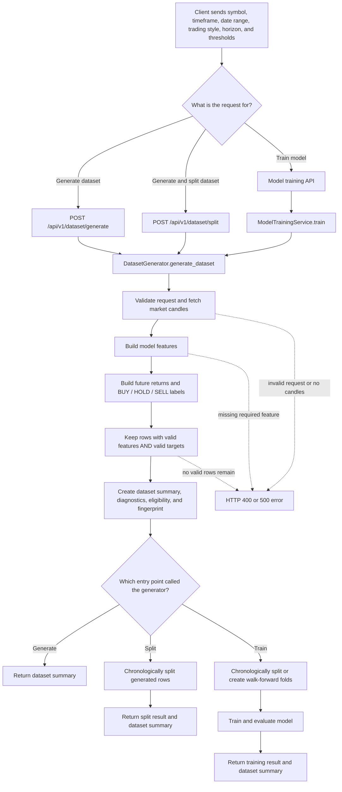
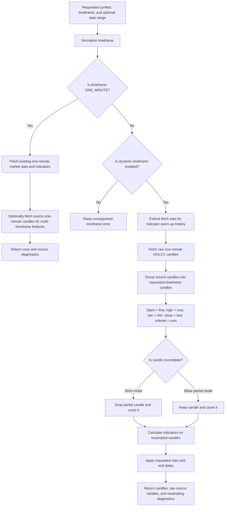
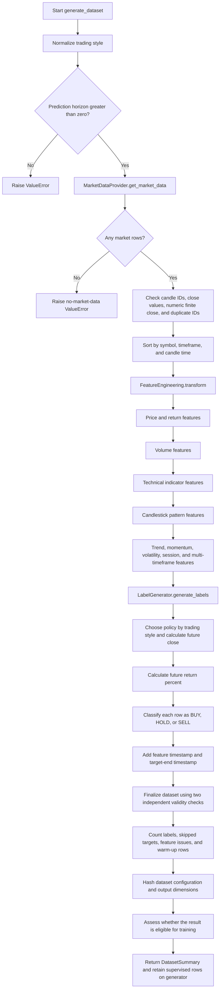
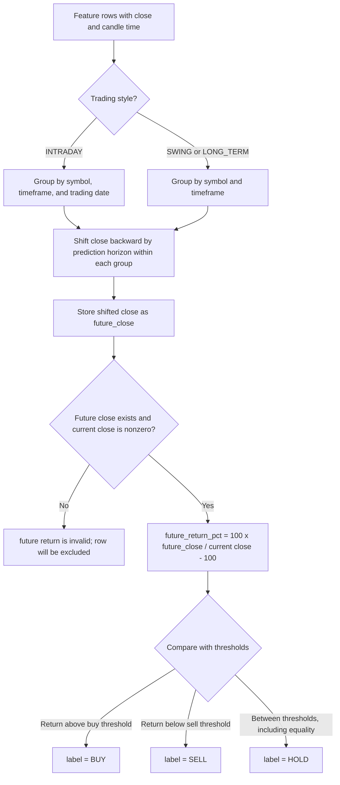
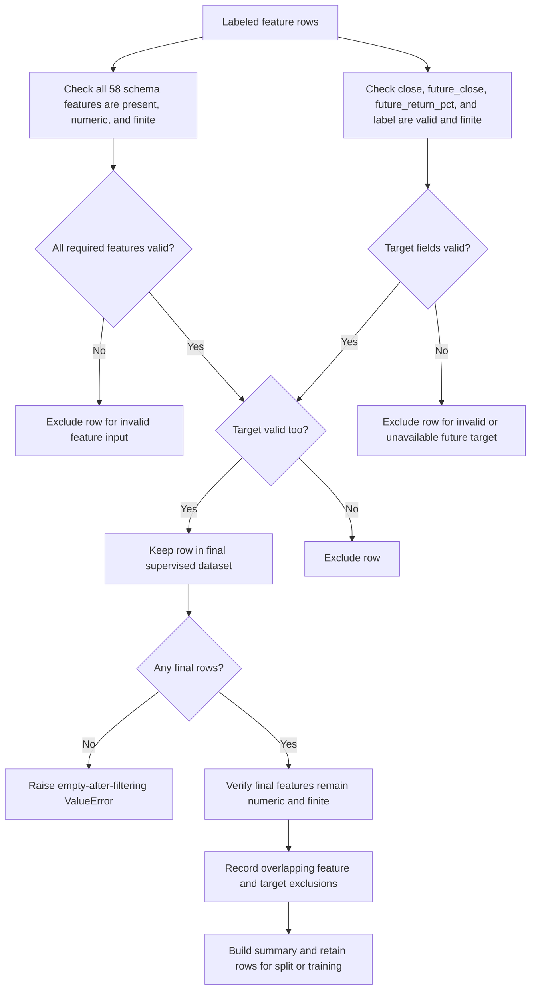
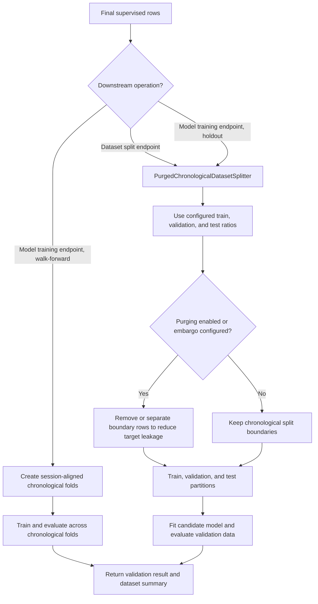

# Trade ML Service: Dataset and Training Flow

This document follows the data from an API request to the final training rows. Each arrow represents data or control moving to the next step. A diamond is a decision; an error branch means processing stops and the API returns an error.

## 1. Entry Points and Big Picture

Use the dataset endpoints to build or split rows without training a model. The model-training endpoint runs the same dataset generator and then continues into validation and model training.

The dataset can therefore be generated without training. Splitting and model training are downstream actions; neither is part of `DatasetGenerator.generate_dataset` itself.

## 2. Market Data: Where the Candles Come From

`MarketDataProvider` routes one-minute requests differently from higher-timeframe requests. A higher timeframe is assembled from raw one-minute candles in memory.

Important details:
- Dynamic resampling is enabled for five-minute, fifteen-minute, thirty-minute, one-hour, one-day, and one-week candles. Unsupported dynamic timeframes fail instead of silently approximating.
- Intraday buckets are anchored to the market session start (09:15). Daily and weekly candles are grouped by date and week respectively.
- Strict partial-candle handling is the resampler default. The diagnostics report source rows, resampled rows, partial candles, and dropped partial candles.
- Warm-up history is fetched before the requested start date so rolling indicators can initialize. The requested date range is applied after indicators are calculated.

## 3. Dataset Generation, One Step at a Time

This is the central path inside `DatasetGenerator.generate_dataset`.

### Request validation and ordering

The generator normalizes `tradingStyle`, rejects a horizon less than or equal to zero, and asks the provider for market data. It then rejects an empty result, missing or null candle IDs, missing or invalid close prices, non-numeric close values, and duplicate candle IDs. Rows are sorted by symbol, timeframe, and candle time before rolling features or future targets are calculated.

### Feature engineering

Feature engineering operates on a copy of the ordered candle data. It builds price, volume, technical-indicator, candle-pattern, and intraday/multi-timeframe values. Persisted indicator columns are reused where available; otherwise selected indicators are computed from the candle history. Multi-timeframe inputs are aligned only when those bars have become available, to avoid using future information.

The model-input contract is version `v3` and contains 58 columns:

| Feature family | Columns |
|---|---|
| Returns and candle shape | `return_1`, `return_5`, `return_15`, `price_range_pct`, `body_size_pct`, `upper_wick_pct`, `lower_wick_pct` |
| Volume | `volume_change_pct`, `rolling_volume_mean`, `relative_volume` |
| Technical indicators | `rsi`, `macd`, `macd_signal`, `macd_histogram`, `atr_pct`, `adx`, `ema_9_distance_pct`, `ema_20_distance_pct`, `ema_50_distance_pct`, `bollinger_position`, `bollinger_width_pct` |
| Candle patterns | `is_doji`, `is_hammer`, `is_shooting_star`, `is_bullish_engulfing`, `is_bearish_engulfing` |
| Trend and momentum | `ema20_slope`, `ema50_slope`, `ema200_slope`, `price_above_ema20`, `price_above_ema50`, `price_above_ema200`, `rsi_change_3`, `rsi_change_5`, `macd_change`, `momentum_3`, `momentum_5`, `momentum_10` |
| Volatility | `atr_ratio_short_long`, `volatility_expansion`, `rolling_std_5`, `rolling_std_20` |
| Session position | `distance_from_day_high`, `distance_from_day_low`, `breakout_day_high`, `breakout_day_low`, `minute_of_day`, `minute_from_open`, `session_progress_pct`, `price_above_vwap` |
| Other timeframes and regimes | `five_min_rsi`, `five_min_macd`, `fifteen_min_rsi`, `fifteen_min_macd`, `one_hour_trend`, `market_regime`, `volatility_regime`, `trend_regime` |

Labels and metadata such as `future_close`, `future_return_pct`, `label`, `featureTimestamp`, and `targetEndTimestamp` are not model input features.

## 4. Target Calculation and Label Meaning

The label describes the observed future price movement, not a guaranteed trade outcome. For each candle the target policy finds a future close `predictionHorizonBars` later, computes the percentage return from the current close, and compares that return with the configured thresholds.

For example, with a buy threshold of `0.5%` and a sell threshold of `-0.5%`, a return greater than `0.5%` is `BUY`, a return less than `-0.5%` is `SELL`, and all other valid returns are `HOLD`. The comparison is strict: a return exactly equal to either threshold remains `HOLD`.

Intraday future prices cannot cross a trading-date boundary. Swing and long-term future prices can continue into later dates, but they remain within the same symbol and timeframe. Rows near a group boundary may have no future candle and thus no valid target.

## 5. Final Row Filtering and Diagnostics

Feature readiness and target validity are checked independently. A row enters the final dataset only when **both** checks pass. Calculating targets before filtering feature warm-up rows ensures the horizon still means the requested number of actual market bars.

Diagnostics distinguish:
- **Indicator warm-up rows:** rows without required indicator history.
- **Feature warm-up rows:** leading rows in each symbol/timeframe group that lack valid model features.
- **Internal invalid feature rows:** invalid feature values after valid values have already appeared; these are not treated as ordinary leading warm-up.
- **Feature-invalid rows:** rows failing any declared feature check.
- **Target-skipped rows:** rows missing a valid future close, return, or label.
- **Overlap:** rows that fail both feature and target checks. Counts can overlap, so they must not be added to infer the final row count.
- **Skip reasons:** target-invalid rows are attributed to insufficient future bars when the whole group is shorter than the horizon; otherwise they are counted as a cross-session horizon. For intraday, the group is one trading date.

The final feature matrix must contain numeric finite values and labels must not be null. Unrelated metadata columns do not determine whether the model features are ready.

## 6. Summary and Training Continuation

The `DatasetSummary` reports request identity, timeframe, horizon, source/resampling counts, warm-up and skipped-row counts, final row and feature counts, schema version, label distribution, skip reasons, feature validation, training eligibility, and a dataset fingerprint.

The fingerprint is SHA-256 over a canonical JSON description of the symbol, trading style, timeframe, horizon, thresholds, feature version and columns, final date range, and final row count. It identifies the dataset configuration and dimensions; it is not a hash of every feature value.

The training service receives the generator's `supervised_rows`; it does not reconstruct labels or features. The configured validation strategy determines whether the service uses a purged chronological holdout split or walk-forward folds. Dataset generation itself only assesses eligibility and reports reasons; downstream training decides whether and how to proceed.

## Code Map

- API dataset routes: [app/api/dataset_api.py](app/api/dataset_api.py)
- Dataset orchestration, filtering, diagnostics, and fingerprint: [app/dataset/dataset_generator.py](app/dataset/dataset_generator.py)
- Market-data routing and resampling: [app/market_data/market_data_provider.py](app/market_data/market_data_provider.py), [app/market_data/candle_resampler.py](app/market_data/candle_resampler.py)
- Feature pipeline and feature schema: [app/features/feature_engineering.py](app/features/feature_engineering.py), [app/features/feature_schema.py](app/features/feature_schema.py)
- Future-return labels and policies: [app/dataset/label_generator.py](app/dataset/label_generator.py), [app/dataset/target_policy.py](app/dataset/target_policy.py)
- Training and chronological split orchestration: [app/training/model_training_service.py](app/training/model_training_service.py)
